# Portfolio Transformation Implementation Plan

**Objective:** Transform [priyanshuchamoli.dev](https://www.priyanshuchamoli.dev) into an elite engineering and personal brand platform that showcases verifiable skills in frontend & full-stack development (React, Next.js, Node.js), networking, cloud infrastructure, Linux, cybersecurity, and automation.

---

## Roadmap Overview & Phases

```mermaid
flowchart LR
    A["Phase 1: Intelligence & Audit"] --> B["Phase 2: Design System & Tokens"]
    B --> C["Phase 3: Real Engineering Projects & Case Studies"]
    C --> D["Phase 4: Technical SEO & Discoverability"]
    D --> E["Phase 5: Content Authority & Engineering Notes"]
    E --> F["Phase 6: Dedicated ATS Resume Page"]
    F --> G["Phase 7: Security & Contact Route Hardening"]
    G --> H["Phase 8: Automated Testing & Verification"]
```

---

## Phase 2: Design System & Visual Hierarchy Polish
**Specialist Skills:** `ui-ux-pro-max`, `frontend-design`, `high-end-visual-design`, `tailwind-patterns`, `wcag-audit-patterns`

### Tasks
1. **Refine Design Tokens in `globals.css`:**
   - Elevate contrast ratios for muted and secondary text to strictly meet WCAG 2.2 AA (minimum 4.5:1 on both dark and light modes).
   - Add refined surface elevation variables (`--bg-surface-elevated`, `--border-interactive`).
   - Implement accessible focus-visible rings with high contrast outline.
2. **Add Skip-to-Content Link:**
   - Implement an accessible `<a href="#main-content" className="sr-only focus:not-sr-only ...">Skip to main content</a>` in `RootLayout`.
3. **Elevate Typography & Code Blocks:**
   - Add copy-to-clipboard buttons and clean language labels on all markdown and code blocks in technical notes.
   - Refine monospace badges and metrics displays.

---

## Phase 3: Showcase Genuine Engineering Projects & Technical Case Studies
**Specialist Skills:** `senior-fullstack`, `backend-architect`, `react-best-practices`, `nextjs-app-router-patterns`, `architecture-patterns`

### Tasks
1. **Feature Real Full-Stack Web Projects from GitHub:**
   - **Project 1: `Auralyn Audio Engine / Music Web App`** (`chamolip81-svg/music-web-app` & `auralyn-backend`):
     - Comprehensive case study at `/projects/auralyn-audio`:
       - Architecture: Client audio engine + Node.js REST API + stream caching + state management.
       - Problem statement: Handling uninterrupted audio playback, buffering strategies, and responsive mobile-first audio controls.
       - Engineering challenges: Memory leaks in HTML5 audio listeners, CORS handling for audio streams, state persistence across page navigation.
       - Interactive audio architecture diagram and live metrics.
   - **Project 2: `Network Quest Simulator`** (`chamolip81-svg/myportfolio`):
     - Promote Network Quest to a primary showcase project in the projects catalog with direct links to play live.
     - Detail the 10-mission client-side simulation engine, deterministic daily challenges, and state machine architecture.
   - **Project 3: `Infrastructure & Workflow Automation Suite`** (`chamolip81-svg/automation`):
     - Showcase shell scripts, CI/CD pipelines, automated testing harnesses, and cron maintenance tasks.
   - **Project 4: `Travel Dost`** (Existing foundational frontend project):
     - Keep as foundational web UI project, showing the progression from foundational DOM manipulation to full-stack reactive applications.
2. **Upgrade Project Cards & Catalog:**
   - Filterable by tech stack (`Full-Stack`, `Systems & Networks`, `Frontend`, `Automation`).
   - Rich metric badges: Tech stack, GitHub link, Live demo, Architecture highlight.

---

## Phase 4: Advanced Technical SEO & Career Positioning
**Specialist Skills:** `seo-audit`, `seo-structure-architect`, `nextjs-seo-indexing`, `schema-markup`, `keyword-clustering-tool`

### Tasks
1. **Align Search Positioning with Career Objectives:**
   - Target queries:
     - *Primary:* Next.js React Developer, Full-Stack JavaScript Engineer, Frontend Web Developer.
     - *Secondary:* Cloud Computing & Infrastructure Developer, Linux Systems & Networking Specialist.
     - *Local & Regional:* Web Developer in Dehradun, Software Engineering Intern.
2. **Structured Data Enhancements:**
   - Add `SoftwareApplication` / `WebApplication` schemas for Auralyn and Network Quest.
   - Enhance `Person` schema with `knowsAbout` including React, Next.js, TypeScript, Node.js, REST APIs, Docker, AWS, and Linux.
   - Update `llms.txt` and `llms-full.txt` to reflect the expanded full-stack engineering portfolio.
3. **Internal Linking Mesh:**
   - Cross-link project case studies with corresponding technical notes and interactive labs.

---

## Phase 5: Content Authority & Engineering Writeups
**Specialist Skills:** `content-strategy`, `copywriting`, `seo-content-planner`, `javascript-pro`

### Tasks
1. **Add High-Impact Modern Web Engineering Article:**
   - *Title:* "State Management, Buffering & Event Loops in In-Browser Audio Streaming Engines"
   - *Slug:* `browser-audio-streaming-engine`
   - *Topics:* HTML5 Audio API, event loops, buffer underruns, Web Audio API vs `<audio>`, reactive state synchronization.
   - Connects directly to the Auralyn case study!
2. **Ensure High E-E-A-T:**
   - Concrete code snippets, ASCII sequence flows, and verified technical references.
   - Automatic inclusion in sitemap, OpenGraph tags, and TechArticle JSON-LD.

---

## Phase 6: Dedicated Native Interactive Resume Page (`/resume`)
**Specialist Skills:** `ui-ux-pro-max`, `frontend-design`, `wcag-audit-patterns`

### Tasks
1. **Build `/resume` Route:**
   - High-performance, beautifully styled, ATS-readable web resume.
   - Print-optimized CSS (`@media print`) so recruiters can press `Ctrl+P` / `Cmd+P` or click "Print / Save as PDF" to generate a perfectly formatted 1-2 page PDF.
   - Clear sections: Contact & Socials, Technical Skills categorized by verified competency (Languages, Frontend, Backend, Networking & Cloud, Tools), Projects with impact metrics, Education (B.Sc. IT at CIMS Dehradun), and Certifications/Explorations.
   - Add to Navigation bar and Command Palette.

---

## Phase 7: Security & Backend Route Hardening
**Specialist Skills:** `security-auditor`, `threat-modeling-expert`, `frontend-security-coder`, `backend-security-coder`

### Tasks
1. **Next.js API Contact Route (`/api/contact`):**
   - Create a server-side route handler with Zod or strict TypeScript validation.
   - Implement honeypot field (`_hp_company`) to trap automated spam bots without CAPTCHAs.
   - In-memory sliding-window IP rate limiter (prevents mail server flooding).
   - Server-side email forwarding with fallback to direct mailto/Gmail links.
2. **CSP Review:**
   - Verify CSP headers against modern Next.js inline script requirements.

---

## Phase 8: Verification, Automated Testing & Documentation
**Specialist Skills:** `test-driven-development`, `testing-patterns`, `lint-and-validate`, `code-review-checklist`

### Tasks
1. **Unit & Integration Tests:**
   - Add automated tests in `src/lib/` for project data integrity, resume metadata, contact API validation, and SEO helpers.
2. **Quality Gates:**
   - `npm run lint` (ESLint 9 passing cleanly with 0 warnings).
   - `npx tsc --noEmit` (TypeScript strict mode passing with 0 errors).
   - `npm test` (All unit tests passing).
   - `npm run build` (Turbopack static generation passing with 100% successful SSG routes).
3. **Documentation:**
   - Update `CHANGELOG.md`, `PORTFOLIO_AUDIT.md`, `DESIGN_SYSTEM.md`, `SEO_STRATEGY.md`.

---

## Resource Impact Statement (8 GB RAM System)
- All tasks utilize native Next.js static generation and lightweight dependencies.
- No heavy local Docker containers or background LLM daemons.
- Build and test commands execute in sub-10-second bursts to preserve system resources.

